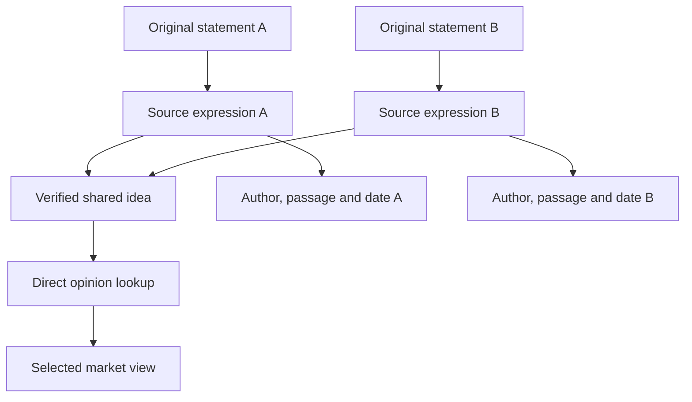

# Axthena — creation-time opinion grouping and direct market views

14 October 2026. Research and proposed mechanism; Badr makes the architecture decisions. Originals, individual source expressions and dates are retained. No model, database, threshold or index implementation is selected, and no fixture/application/live Aura data was changed.

## Corrected understanding

Badr wants a mechanism that works while acquired material is being processed: inspect an incoming expression, look for compatible existing meanings, and attach it to an existing Idea when it expresses that meaning. Otherwise create a new Idea. Later, a market-opinion view should query those Ideas directly instead of rediscovering them through subsidiaries and dependency paths.

This is **incremental semantic grouping with candidate retrieval**, conceptually related to interning: reuse a shared representation after deciding equality. Exact hash-consing can establish equality of structured terms [R10]; natural-language meaning requires a fallible, separately evaluated comparison. A content hash cannot decide paraphrase equivalence.

The behaviour refines Axthena's existing shared-meaning direction, rather than replacing the original evidence model. Grouping runs during preparation; later read queries remain separate under ENG-004.

## Earlier app/context lookup

Searches of named Library items and Notion found no confirmed Pandea/Pangea app record. Personal-context retrieval recovered a related August 11, 2025 COBOL-abstraction discussion: file/instruction/instruction-type/subpattern regions; compare an incoming snippet with existing regions; route to a match or create a region; retain shared memory; allow overlapping regions. The exact project name and repository were not recovered. This is a related earlier pattern, not proof that the app was called Pandea.

The reusable insight is routing material into an existing meaning structure. Overlapping broad topics/regions are compatible with that insight; exact opinion-group membership still requires its own meaning rule. Do not treat a topic region as one agreed opinion or import the previous project's architecture.

## Mechanism that fits the clarified goal

1. **Retain the original and source Expression.** Its author/account, publication, exact span, availability and processing version remain distinct. Replaying the same source version/extraction does not create another expression; a new publication of copied wording still has its own identity.
2. **Extract a comparison contract.** Preserve the target stock or other subject, organisation/subsidiary/domain scope, optional UP/DOWN direction, proposition, metrics and bases, period wording and anchor, reasoning, conditions and modality. Source agreement remains on the Expression; it does not decide identity. Insufficient source information follows the existing extraction-failure rules rather than inventing a meaning.
3. **Retrieve a few plausible Ideas.** Use exact verified keys where available, lexical matching and/or embeddings. An embedding is a numerical representation used to find nearby text. Nearby source dates can prioritise candidates; do not use proximity as proof of equality. Search recent candidates first with an older-compatible fallback if needed.
4. **Check material differences.** Opposite direction, another subsidiary, a different reason, metric basis, meaningful period or condition prevents a merge under the applicable rule. Known omission differs from extraction uncertainty. A default near-term label does not make an untimed statement identical to an explicit two-week forecast.
5. **Verify equivalent meaning.** A pair classifier or LLM examines the candidate contract and source-backed representative, returning equivalent, different or uncertain. A cross-encoder reads the pair together; a retrieval reranker estimates relevance and is not automatically an equivalence judge. Entailment in both directions can be an additional signal, not proof or independent probability.
6. **Reuse or create.** A verified equivalent points to the existing Idea. A valid expression with no verified match becomes a new singleton Idea. Uncertain matching also remains separate, with its decision trace retained. This is distinct from the external-confirmation/on-hold process for facts.
7. **Update direct opinion lookups.** Index Ideas and their source memberships by relevant subjects, direction, period and other selected facets. The market view begins there; supported stock relevance mappings can also be prepared from corporate context without changing the expression's literal subject.

Example: Mira and anonymous account A say NOVA will rise during the same stated interval because N1 improves NovaChip's competitive position. Their two Expressions can point to one Idea. A third UP statement based on shipping-cost reductions points to another Idea, even though target, direction and period match. The two Ideas can appear together in a market view.

The diagram represents a verified merge. Candidate retrieval and the comparison decision occur before the Expressions share that Idea. Distinct wording and evidence remain recoverable.

## What the strongest relevant benchmarks establish

No verified benchmark tests Axthena's exact requirement: same stock opinion, organisation/domain, direction, forecast meaning, reason and conditions, grouped incrementally while retaining all original evidence. The best available results below measure different parts of that problem. Their numbers must not be ranked against one another as if they were the same accuracy measure.

| Technique and primary result | Exact result | What it establishes | Transfer limit |
|---|---|---|---|
| Santos/Mendes/Miranda 2022 online multilingual news rank→accept→merge, MIRANDA chronological test, Table 3 [R1] | B-cubed F1 **90.10%**, pairwise F1 **97.21%**; Linger baseline **82.06% / 86.49%** | Existing clusters can be found, accepted or created as news arrives. Uses embeddings and timestamps; supervised rank/accept/merge. | Labels identify stories, not equivalent opinions. 20,813 training and 13,874 newer test articles; hardware unspecified. |
| Claim2Vec 2026, fine-tuned BGE-M3 plus agglomerative clustering, Tables 4–5 [R2] | MultiClaim-Test **ARI 0.626 / AMI 0.758**, versus BGE-M3 **0.610 / 0.726** | Closest recent claim-clustering study located; domain-specific representations improve grouping on its labels. | Preprint, offline clustering, same-fact-check task. Uses 28K positive training pairs and a topic-disjoint test; not a stock-opinion or online-admission benchmark. |
| Agent-generated prompt with Mistral 7B, ClaimMatch, Table 2 [R3] | **F1 96.9% / accuracy 96.9%**, versus best hand-crafted prompt **95.0%** | Few-shot pair matching can perform strongly on a fixed balanced 1,000-pair test. | Its definition allows contradictory claims to match if verified by the same evidence. The winning configuration does not prove bullish/bearish equality or precision under rare duplicates. |
| PINGAN AI, official SemEval 2025 Task 7 winner [R4] | Language-average Success@10 **0.9601 monolingual / 0.85875 crosslingual** | Strong official candidate retrieval: a matching fact-check appears in the first ten results. | No winner system paper/code/hardware verified. Top-ten success does not decide whether to attach, reject or create an Idea. |
| BERT versus SBERT on Argument Facet Similarity, original 2019 Table 3 [R5] | Cross-topic Spearman **60.34% BERT-AFS-large / 53.10% SBERT-AFS-large**; cross-validation **76.38% / 75.93%** | This task requires similar claims and similar reasoning. Pair attention is useful; transfer to new topics is harder. | Historical comparison, not current SOTA; correlation is not attachment accuracy. |

**Claim2Vec is a candidate, not the answer.** Its dataset lineage uses partly LLM-labelled, transitively linked pairs [R6]. Its tables do not show one universal winner: ClaimCheck ARI is 0.907 for GTE-Qwen2-1.5B versus 0.906 for Claim2Vec. Table 3 reports large-test 0.625/0.757, slightly different from Tables 4–5.

**Metric meanings:** F1 balances precision and recall. B-cubed evaluates whether each item's cluster contains the right companions. ARI and AMI measure agreement with reference clusters after chance adjustment; 0.626 is not "62.6% of opinions correct." Success@10 measures finding a relevant candidate somewhere in ten results. Spearman measures similarity-ranking agreement. None is a price-prediction score.

## Current embedding candidates, separately from equality decisions

The official MTEB API was fetched on October 14, 2026. These rows have scores on all 131 Multilingual v2 tasks. The snapshot is included as `Axthena-opinion-grouping-benchmark-snapshot.json`.

| Model | Parameters, approximately | Vector dimensions | Overall mean-task score ×100 | Retrieval task-type score ×100 | API zero-shot coverage |
|---|---:|---:|---:|---:|---:|
| Harrier-OSS-v1-27B | 27B | 5,376 | **74.272** | **78.265** | 78% |
| Qwen3-Embedding-8B | 8B | 4,096 | **70.584** | **70.877** | 99% |
| Harrier-OSS-v1-0.6B | 0.6B | 1,024 | **69.013** | **70.754** | 78% |
| Qwen3-Embedding-0.6B | 0.6B | 1,024 | **64.336** | **64.647** | 99% |

Harrier 27B has the highest observed mean-task score among rows with complete 131-task coverage in this snapshot. That is a precisely scoped observation, not a universal best opinion matcher. Training exposure differs; the API's rank field also does not consistently sort by mean-task score. The 18 multilingual retrieval tasks combine NDCG@1, NDCG@10 and Recall@10, so that column is not pure NDCG@10 or identity accuracy. Official cards support the named model families [R7–R8].

For initial evaluation, compare the two 0.6B candidates rather than assume the largest model is worth its cost. Include Claim2Vec as a domain-specific candidate if its task definition is appropriate. Choose using Axthena admission precision and processing cost; no local Mac/C++ latency or quantised-model equivalence was measured. Model inference integration remains unselected.

## Fast indexing: what the benchmarks do and do not prove

An Idea index avoids comparing each new expression with every old publication. For a small Idea catalogue, exhaustive vector comparison is a sensible reference. Approximate nearest-neighbour search (ANN) trades some missed vector neighbours for lower search work; it does not validate meaning.

VIBE's pinned July 31, 2026 published results give the following fastest tested configurations per algorithm with **Recall@100 at least 95%**, using precomputed vectors [R9].

| Implementation | Yahoo MiniLM: 677,305 ×384 vectors | MS MARCO Qwen: 8,840,823 ×1,024 vectors |
|---|---:|---:|
| hnswlib | 95.684% recall / 1,710 queries/s | 95.524% / 1,364 queries/s |
| Glass | 97.159% / 4,715 queries/s | 97.336% / 2,987 queries/s |
| SymphonyQG | 95.699% / 4,191 queries/s | 96.886% / 3,898 queries/s |

The achieved recalls differ. VIBE uses Xeon Gold 6230, one physical core per worker, disabled SMT, NUMA binding, 1,000 held-out queries and fastest timing of five runs. Embedding generation and semantic verification are excluded. These published results are not Axthena/Mac measurements and do not establish HNSW as the universal winner.

The first index choice should follow catalogue size and measured cost. Native C++ options exist; no engine or library is selected. The main Axthena application remains C++.

## Mathematical form of the proposed reduction

Let \(E\) contain all retained source Expressions, and \(E_{\rm valid}\subseteq E\) those with a sufficiently supported extracted meaning. Let \(I\) contain shared Ideas. A grouping revision \(r\) supplies a mapping

\[
g_r:E_{\rm valid}\to I.
\]

Retaining \(E\) preserves originals and source distinctions; shared meaning is stored once per Idea. The mapping is a recorded interpretation, not proof of linguistic equality. A merge must not erase the defining subject, period, rationale or condition.

A candidate's text similarity \(s(x,I)\) supplies a search order. Admission instead requires

\[
\operatorname{attach}(x,I)=
\operatorname{compatible}_{p}(K_x,K_I)
\land\operatorname{verify}_{p}(x,I)=\text{equivalent},
\]

where \(K\) is the source-backed meaning contract and \(p\) is the recorded policy/model version. Unknown material facets are not wildcards. Compatibility of periods is an explicit policy choice, not an unspecified time-distance threshold. A verifier score is not calibrated probability by default.

A representative or centroid may help retrieve candidates. It must not drift the meaning of already accepted members. Compare against a frozen semantic contract and representative; use additional witnesses when needed. Approximate closeness is not transitive: A resembles B and B resembles C does not establish A and C are equivalent. Agglomerative/connected-component results cannot simply replace admission checks.

For \(N\) incoming Expressions and \(M\) existing Ideas, full pair search costs approximately \(O(NMd)\) vector work for dimension \(d\). Candidate retrieval limits expensive pair verification to approximately \(Nk\) calls for \(k\) candidates, provided candidate recall is adequate. ANN complexity/latency is implementation- and data-dependent; do not promise a universal logarithmic bound.

\[
C_{\rm expression}=C_{\rm extract}+C_{\rm embed}+C_{\rm retrieve}+kC_{\rm verify}.
\]

The index may make lookup cheap while extraction/verification dominates. Avoid repeated extraction/embedding for identical immutable source inputs under the same processing version, while preserving separate publication identities.

Float32 vectors require \(4dM\) payload bytes. At 100,000 Ideas, dimension 1,024 needs about 390.6 MiB; dimension 4,096 about 1,562.5 MiB, excluding metadata/index/graph overhead. This is a capacity calculation, not measured compression or application memory.

## Direct market view

A lookup can return Ideas over the configured market/universe directly by opinion kind, targets, source selection and dates. Original corporate/supplier paths can remain inspectable; the query need not repeat their discovery. Stock relevance inferred from subsidiaries or suppliers remains labelled and retains its dated support. A supplier opinion does not automatically become a stock-price prediction.

For view \(V\), source cutoff \(t\) and grouping revision \(r\), select

\[
E_{I,V,t,r}=\{x:g_r(x)=I,\ \operatorname{source}(x)\in V,
\ A(x)\le t,\ \operatorname{allRequiredSupportEligible}(x,t)\}.
\]

Here \(A(x)\) is the supported first availability of the source version used by the expression, distinct from collection and derivation times. Unknown availability follows the still-unselected historical-read policy. Return an Idea only when this eligible set is nonempty. Compute publication count, distinct accounts, known originating sources and agreement counts independently. Ten repeated publications do not become ten independent confirmations or a representative measurement of the market.

This view is over Axthena's configured sources and stocks, initially NVDA/MSFT and their surroundings; it does not expand V1 into complete market coverage. Personal opinions and directional judgments on organisation news retain their existing category/source distinctions. Exact view filters remain configurable/unselected.

**History:** memberships need recorded policy, decision time and Idea revision. A grouping merge/split adds a new revision and retains its predecessor memberships. Querying current counts as if they existed historically is invalid. Source-first retrospective reads may use explicitly dated later analysis; they do not claim Axthena actually produced it then. Learned classifications or future supporting evidence are not silently backdated. Active edit tracking and detailed concurrent readiness remain deferred.

## Small evaluation before selecting a method

The companion `Axthena-opinion-grouping-review-cases.json` supplies fictional cases from accepted rules and marks unresolved temporal policy separately. It is a reviewed-proposal evaluation packet, not a validated benchmark or model result.

Measure candidate recall@k, accepted-attachment precision, missed equivalents, uncertain decisions, group impurity, ingestion-order sensitivity and processing latency/cost. Include Chinese/English paraphrases if those source languages are selected. Hold out sources/time periods and keep syndicated copies together to avoid an easy copy-based evaluation. Evaluating inference quality is data preparation validation; no predictive-model training is proposed.

False merges contaminate meaning and metrics; missed merges preserve separate evidence and can be corrected later. A proposed quality objective gives false merges greater cost than fragmentation. The owner still selects that trade-off and acceptance targets. Do not pick a universal cosine threshold from an unrelated leaderboard.

## Unresolved owner choices

- Whether the same relative horizon on nearby publication days denotes one shared Idea with per-Expression anchored forecasts, or separate forecast-episode Ideas.
- The grouping contract's degree of specificity, including missing-but-clearly-omitted reasons versus material ambiguity.
- Candidate time range, older-candidate fallback, candidate count, verifier and threshold/abstention policy.
- How a market view combines personal opinions and stock-direction judgments in organisation news.
- Concrete throughput, memory and error targets before choosing a vector index/model.

These are focused design choices. Original retention, traceability and the earlier different-reason/different-stated-period safeguards remain accepted requirements.

## Primary reference register

**R1 — Online clustering.** João Santos, Afonso Mendes, Sebastião Miranda (2022), [paper](https://ceur-ws.org/Vol-3117/paper2.pdf), Table 3 and methodology; [code](https://github.com/Priberam/projected-news-clustering). Reviewed chronological clustering and reported scores. Transfer only the rank/accept/create structure; story labels are not opinion identity.

**R2 — Claim2Vec.** Rrubaa Panchendrarajan, Arkaitz Zubiaga (2026), [v2 preprint](https://arxiv.org/html/2604.09812v2), Tables 3–5; [weights](https://huggingface.co/Rrubaa/claim2vec). Reviewed claim clustering and protocol. Training code/hardware and peer-reviewed venue not verified; no fine-tuning selected for Axthena.

**R3 — Pair matching.** [Agent-based Automated Claim Matching, Findings IJCNLP 2025](https://aclanthology.org/2025.findings-ijcnlp.146.pdf), Table 2 and error analysis. Reviewed best within-paper result and contradictory-claim semantics. It is not a same-opinion verifier benchmark.

**R4 — Official retrieval competition.** [SemEval 2025 Task 7 overview](https://aclanthology.org/2025.semeval-1.323.pdf), official result tables. Reviewed winners and Success@10 definition. Winner system details were unavailable; no reproducible winning pipeline is claimed.

**R5 — Reason-sensitive similarity.** Nils Reimers, Iryna Gurevych (2019), [Sentence-BERT](https://aclanthology.org/D19-1410.pdf), §4.3/Table 3; Amita Misra and colleagues (2016), [Argument Facet Similarity](https://aclanthology.org/W16-3636.pdf). Reviewed distinction between descriptive similarity and matching claims plus reasons; historical comparison, not current model selection.

**R6 — Dataset construction.** Panchendrarajan, Míguez, Zubiaga (2025), [MultiClaimNet](https://aclanthology.org/2025.findings-emnlp.599.pdf), claim-pair linking and limitations. Reviewed multi-language claim grouping; labels are partly automated and transitivity does not guarantee Axthena meaning preservation.

**R7 — Current embedding benchmark.** [Official MTEB repository](https://github.com/embeddings-benchmark/mteb), [live multilingual v2 scores API](https://mteb-leaderboard-backend.hf.space/v1/benchmarks/MTEB%28Multilingual%2C%20v2%29/scores). Independently fetched official JSON, retained selected score/task-coverage snapshot. Rank, coverage and mixed metrics are distinct; no opinion-merging accuracy derived.

**R8 — Official model cards.** [Harrier 27B](https://huggingface.co/microsoft/harrier-oss-v1-27b), [Harrier 0.6B](https://huggingface.co/microsoft/harrier-oss-v1-0.6b), [Qwen3 8B](https://huggingface.co/Qwen/Qwen3-Embedding-8B), [Qwen3 0.6B](https://huggingface.co/Qwen/Qwen3-Embedding-0.6B). Reviewed model sizes, output dimensions and published scores/instructions. No Mac latency measurement or quantisation-equivalent quality claim.

**R9 — ANN performance.** [VIBE v3](https://arxiv.org/html/2505.17810v3); [pinned published results](https://raw.githubusercontent.com/vector-index-bench/vector-index-bench.github.io/9841a87385af0a2ce43efd61fca70dd7c4f40b4b/results/summary.parquet). Protocol reviewed; an independent agent reproduced rows filtered by `k=100`, `recall>=0.95`, maximum QPS per dataset/algorithm. [Faiss documentation](https://github.com/facebookresearch/faiss/wiki/Faiss-indexes) supplies the exact-search reference.

**R10 — Representation sharing.** Jean-Christophe Filliâtre, Sylvain Conchon (2006), [Type-Safe Modular Hash-Consing](https://usr.lmf.cnrs.fr/~jcf/ftp/publis/hash-consing2.pdf). Reviewed exact structured-term sharing. Natural-language equivalence is an additional fallible decision; OCaml/library adoption is not proposed.

**R11 — Candidate reranking and adversarial checks.** [That is a Known Lie (2020)](https://aclanthology.org/2020.acl-main.332.pdf), retrieval/reranking distinction; [Adversarial NLI (2020)](https://aclanthology.org/2020.acl-main.441.pdf), adversarial inference failures. Reviewed relevant task definitions; no full training procedure or NLI score is recommended.

**Excluded as a direct benchmark:** [SemDeDup (2023)](https://arxiv.org/abs/2303.09540) removes semantic duplicates from training corpora and evaluates learning efficiency. Its data-removal rate does not validate preserving individual opinion identities or grouping precision. It remains a research analogy, not permission to discard Axthena originals.
