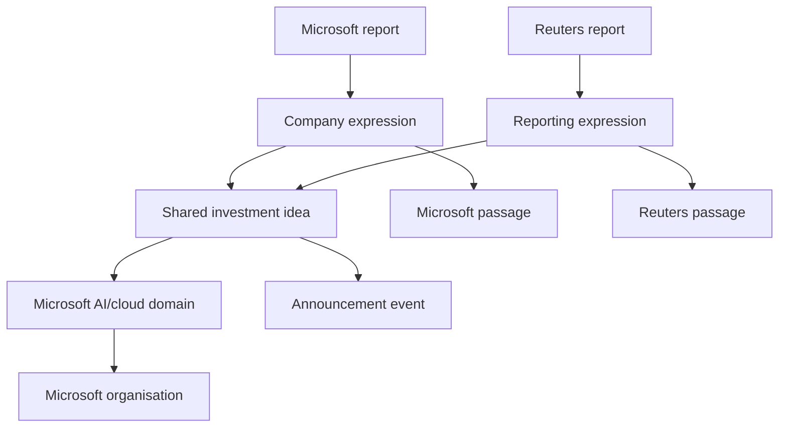
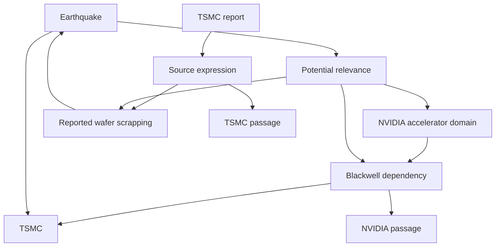

# Axthena — Cypher example from real reports

Date: 2026-10-14. Status: proposed representation for review, not an accepted schema or a database selection.

The aim is to inspect whether the agreed stock-related world survives a concrete graph representation. Public article pages were retrieved and inspected. This small packet retains source links, displayed dates, selected exact passages and proposed extracted records. It contains five reports, seven ideas, eight individual expressions and ten read-query examples.

[Cypher example](Axthena-cypher-example-v1.cypher)

## Real source packet

The names below are descriptive labels, not verbatim headlines.

| ID | Source day | Source | Selected material |
|---|---|---|---|
| R1 | 2025-01-03 | [Microsoft corporate blog](https://blogs.microsoft.com/on-the-issues/2025/01/03/the-golden-opportunity-for-american-ai/) | AI policy position and planned infrastructure investment; resource context. |
| R2 | 2025-01-03 | [Reuters](https://www.reuters.com/technology/artificial-intelligence/microsoft-plans-spend-80-bln-ai-enabled-data-centers-fiscal-2025-cnbc-reports-2025-01-03/) | Reporting of the same company's investment announcement. |
| R3 | 2025-02-10 | [TSMC release](https://pr.tsmc.com/english/news/3204) | Monthly revenue disclosure and earthquake-related wafer scrapping. |
| R4 | 2024-03-18 | [NVIDIA announcement](https://nvidianews.nvidia.com/news/nvidia-blackwell-platform-arrives-to-power-a-new-era-of-computing) | Blackwell announcement and its stated TSMC manufacturing process. |
| R5 | 2025-02-24 | [Reuters](https://www.reuters.com/technology/microsoft-shelves-ai-data-center-deals-sign-potential-oversupply-analyst-says-2025-02-24/) | Lease claims and company response. |

R4 is older background evidence for a dependency; the main episode is in January–February 2025. This is a small packet, not a one-year collection.

The example stores only short exact excerpts, not full original articles. Each excerpt has its source version reference and paragraph/section locator. Full-original retention remains required for the eventual product. The current pages were inspected in 2026; their original historical wording and globally earliest availability were not verified. The dates are therefore explicitly displayed-source dates for this design review.

## What the graph represents

A stock points to an organisation. Its domain carries a broad process and output description, and connects to relevant suppliers or resources through a dependency record. Information records keep reports, extracted meaning, individual expressions, passages, events and scoped confirmation separate.

An organisation-specific domain preserves the organisation/domain pair. A shared idea can concern multiple such domains without splitting into multiple independent opinions.

The important reporting structure is:

The information origin attaches to each expression. This matters for R5, whose two expressions have different origins: a research institution and the company. Author, publisher and originating information source are separate links.

R1 and R2 share the investment idea. They remain two reports and two expressions, with one named originating organisation for that information. This does not claim verbatim copying or independent confirmation. R1 also develops a broader policy position, retained as a separate idea. Grouping these meanings is an assistant proposal for review.

R3 develops two subjects and therefore has two extracted ideas. They remain attached to one report, with distinct supporting passages.

## The supplier case

The dependency is scoped to the product described in R4. It does not prove delivery, capacity, uninterrupted continuity or which products were affected. The additional relevance interpretation explicitly records uncertainty; it does not assert an NVIDIA operational or stock-price effect.

The earthquake's event date and the later release date are separate. Q3 illustrates why filtering by event occurrence alone would place later information into an earlier decision picture. It does not claim that no earlier reports existed elsewhere.

## Facts, news and judgments

The four Fact records deliberately have precise company-disclosure scope. Each points to a Confirmation record with an external origin, process and passage. A statement announcing future activity is not confirmation that the activity was completed.

News expressions remain distinct from those fact records. R2 is provisionally classified as confirmed for the scope of the company's announcement. The lease allegation in R5 is provisionally rumoured pending qualifying confirmation. The classification of its relayed company response is left visibly undecided: the exact rule for accepting that source/process is not yet selected. These are fixture choices for review, not a final trusted-source policy.

Neither this packet's business assessments nor its article-reported price change establish a supported future stock UP/DOWN judgment. The script creates no Judgment nodes. R5's reported response is a source assertion, not an OHLCV-validated observation and not a forecast.

Quoted third-party judgments are not converted into the publisher's judgment or agreement. First-party statements and reported factual claims remain inspectable under the existing scope.

Agreement is not guessed from routine reporting. Each expression currently says it was not assessed; it is not assigned weak/zero or treated as endorsement. Person vectors use explicit dummy values solely to show their separate, domain-independent attachment. No empirical scoring or predictive model is included.

## Views and traceability

Two example views select exact publication channels: company sources, and those same channels plus Reuters. They reuse the shared ideas; they do not duplicate the corpus or claim to represent all media. The view definitions and these interpretations were made in 2026, not historically in 2025.

Source time, retrieval day and extraction day are separate. Original historical versions are flagged unverified. A displayed date is not proof of historical content eligibility. The queries using dates are retrospective design demonstrations, not certified backtests or a chosen opening/closing cutoff contract.

Operational collection and extraction state is not added as news/event nodes. The illustrative processing reference on derived records resolves to this separate description:

| Metadata | Value |
|---|---|
| Processing reference | example-extraction-2026-10-14-v1 |
| Method | Assistant review of retrieved public reports, followed by proposed graph mapping |
| Inputs | R1–R5 and their selected passages; Axthena business decisions AX-001–052 and engineering context |
| Instructions | Preserve source assertions, uncertainty, exact passage links, separate ideas, optional stock direction and dated evidence |
| Model/version | Exact runtime model identifier not exposed; no invented identifier |
| Output | This proposed Cypher fixture and review |
| Processing date | 2026-10-14 |
| Configuration | Analyst-selected primary MSFT/NVDA, supporting TSMC, AI/cloud and accelerator domains, electricity/cooling, and the five named reports |
| Cost | No data-provider subscription purchased; no acquisition or LLM billing total measured |

## Query checks

These are expected results derived by inspecting the fixture. They have not been executed in a graph engine.

| Query | Meaning | Expected result |
|---|---|---|
| Q1 | Shared meaning versus publication and origin counts | One investment idea, two reports/channels, one named origin. |
| Q2 | Inspect each source expression | Separate passages, dates, categories and available responsible people. |
| Q3 | Event date versus source-information date | This later quake report contributes nothing at the earlier cutoff. |
| Q4 | Explain supplier relevance | Stated dependency and potential interpretation stay separate. |
| Q5 | Inspect domain inputs | Evidence-supported broad electricity/cooling context. |
| Q6 | Inspect confirmation | Four company-disclosure-scoped facts with their origin/process. |
| Q7 | Compare selected-source views | One investment expression in the company view, two in the mixed view. |
| Q8 | Price response versus forecast | An article-reported response; no invented stock judgment. |
| Q9 | Surface a pending rule | An undecided classification remains visible. |
| Q10 | Inspect topology | The full example graph can be returned for a graph-capable viewer. |

## What still needs iteration

This example proposes auxiliary Expression, EvidenceVersion, Passage, Confirmation, Dependency and Interpretation records so evidence can be inspected directly. They are not all newly accepted mandatory node types. In particular, making a dependency its own record instead of a property-bearing relationship is a modelling choice for review.

The packet exercises shared meaning, multiple ideas, broad dependencies, resources, company facts, organisational reporting, views and dates. It does not yet exercise personal opinions, anonymous accounts, supported UP/DOWN judgments and their periods, opposing source agreement, conflicting confirmations, corporate groups, war or Chinese-competitor episodes. No unsupported example is invented to fill those gaps.

Whether these records are too detailed for V1, what qualifies a confirmation, exact idea-equivalence criteria and insufficient-information rules remain open. Storage and performance still need evaluation against concrete reads.

## Validation and usage

The fixture has 80 explicitly identified nodes and 148 explicitly identified relationships. Every relationship endpoint resolves; passage references and report origins were checked; selected verbatim excerpts stay within 25 words per article. Property values are flat types suitable for Cypher properties.

The script was reviewed structurally and against primary Cypher documentation. Fixture checks also confirmed two reports/one named origin for the shared investment idea, and zero/one source-dated quake ideas at the two example cutoffs. It has not been parsed or run by Neo4j, and no performance claim is made. The loader is followed by ten numbered read examples. Use an empty disposable database if executing the illustration; no engine has been installed or selected for Axthena.

Cypher references: [CREATE](https://neo4j.com/docs/cypher-manual/current/clauses/create/), [MATCH](https://neo4j.com/docs/cypher-manual/current/clauses/match/), [constraints](https://neo4j.com/docs/cypher-manual/current/schema/constraints/). This illustrates a graph language; it does not choose Neo4j as the product database.

Start the review with R1/R2: does sharing one idea while preserving both source expressions capture the intended meaning?
