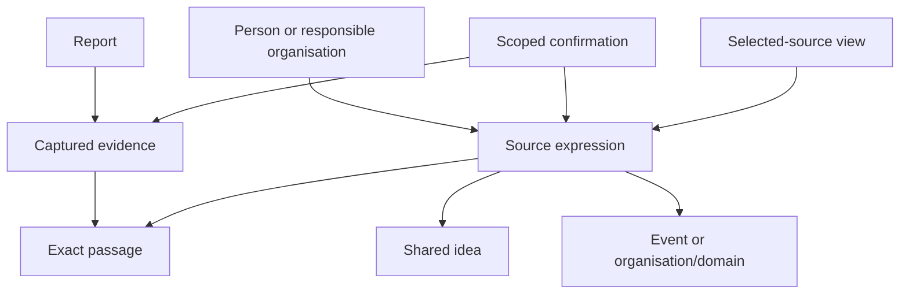

# Axthena — three research and design rounds

14 October 2026. **Proposed specification for owner review. No product implementation has started.** Subsequent accepted decision ENG-016 selects **C++ as the main application language**, for CV value and performance. It supersedes the earlier Python proposal; the exact standard, libraries and backend remain unaccepted. Badr retains the final architecture decisions. Public references are indexed in [the research catalogue](Axthena-research-catalogue-2026-10-14.md); the conditional build sequence is in [the proposed plan](Axthena-proposed-implementation-plan-2026-10-14.md).

## Read this first

The first useful Axthena should let Badr ask: **“For Nvidia or Microsoft, what information was available by this date, who expressed it, what business relationships make it relevant, and where is the evidence?”** It should then return inspectable records and modest numerical counts that Qaedalus and Lexongine can consume.

My strongest recommendation is an **evidence-backed statement graph**. Keep the original material; preserve each source’s expression; share meaning through explicit, reversible grouping; and make confirmed facts a separately supported, dated assessment. The graph remains the game of organisations, domains, people, events, resources, relationships and views.

With ENG-016, the proposed stack is **a typed C++ preparation/query application, an immutable compressed evidence archive, and one Ladybug graph store per published dataset version**, opened read-only for queries. “Embedded” means the database runs inside the application, without a separate database service. C++ is accepted; the database and other mechanisms remain recommendations. Neo4j Community remains a credible alternative. Neither has been benchmarked on Axthena.

| Recommendation | Confidence | Why / remaining evidence |
|---|---|---|
| Preserve evidence separately from derived assertions | High | Direct requirement; provenance and compiler/build-system foundations agree. |
| Shared ideas plus distinct source expressions | High | Preserves meaning, spread, attribution and traceability. |
| Dated confirmation and grouping decisions | High | Prevents silent authority changes and overwritten history. |
| Typed stages, exact caching and bounded reads | High | Addresses real repeat-work and failure cases without a custom optimiser. |
| One authoritative structured store plus evidence archive | High | Avoids competing live databases and synchronization. |
| Ladybug as the physical store | Medium | Good local/Cypher/phase-separated fit; recovery, dialect and migrations need validation. |
| C++ as the implementation language | Accepted, ENG-016 | Owner selected CV value and performance; exact standard/build/dependencies and measured performance remain open. |
| Exact source packet, extraction quality and full-year cost | Undetermined | Need authenticated samples and measured tokens; documentation cannot settle coverage. |

The work consisted of primary-source research, successive design revisions, counterexamples and independent reviews. It did **not** run the Cypher fixture, install databases, acquire an authenticated annual corpus, benchmark queries or test predictive performance.

## The context that governs this recommendation

The current business context AX-001–AX-052 and engineering context ENG-001–ENG-014 were read. The two prior model reviews and the real-report Cypher walkthrough were reconciled with them. Later instructions prevail over earlier exploratory rules.

Preserved: two primary stocks, NVDA and MSFT; broad supplier/resource/competition context; multiple domains per organisation; separate stock identity and organisation/group links; news versus personal opinion; confirmed/rumoured news; precise external confirmation; conflicting confirmations on hold for Badr; most-articulated ideas, with two separately developed ideas allowed; short summaries and exact passages; source-expression agreement; domain-independent person vector; anonymous individual identities; optional UP/DOWN judgments and horizon basis; retained evidence; source-first historical information; preparation before reading; clean domain records separate from operational metadata.

Still deferred: roles, empirical person scoring, predictive training, detailed third-party judgment extraction/scoring, active article-edit tracking, projected future world states, concurrent live reads and real-time operational readiness. A captured version remains retained even though V1 does not discover its edit history.

The earlier Cypher specimen contains five real reports, 80 nodes, 148 relationships and ten illustrative queries. It was structurally reviewed, not executed. It retains short excerpts, not a complete original-source archive, and does not certify historical wording. Its auxiliary nodes are proposals, not automatically mandatory product entities. It usefully exposed the need to attach information origins **per expression**, because one article can relay several sources.

## Engineering reasoning method

Identify components, relationships, decision information, constraints and invariants, then test concrete counterexamples. Personal-study framing and private-note links are omitted from this repository edition.

| Problem observation | Intuition | Structure / operation | Invariant | Test |
|---|---|---|---|---|
| Two outlets repeat the partnership | Meaning can be shared; expressions remain different | Idea with separate expression links | Grouping never removes provenance | Two reports, one shared idea, each passage retained |
| A new rumour is downloaded after a filing | Retrieval recency is not authority | Concurrent assertions plus confirmation decisions | No newest-input-wins truth rule | Late rumour does not revoke the filing-based assessment |
| A quake reaches a stock through a supplier | Relevance follows typed links | Bounded dependency traversal | Path is evidence context, not price causality | Return each hop and its support without inventing DOWN |
| An extraction fails | Acquired evidence still has value | Retained artifact and separate attempt status | Retry does not re-download or add a publication | Same bytes reused; failed attempt absent from completed model |
| A run is queried again next month | State and rules must be pinned | Published generation manifest | Same retained run and query reproduce the result | New grouping leaves old generation unchanged |

## Round 1 — explore precedents and competing designs

### Loose ideas

1. Treat the world as a temporal knowledge graph, with articles as its memory.
2. Treat processing as compilation: source material becomes a typed intermediate record, then a queryable model.
3. Treat configuration like biological regulation: a stable core can support different sources and views.
4. Treat repeated meaning as a shared structure, while retaining the events of people expressing it.
5. Treat the workflow as a build system that reuses completed work instead of repeating paid calls.

These were hypotheses. Their similarity to established ideas was not proof of fitness.

### Plausible combinations and primary checks

Graphiti supplies temporal/episode patterns, GraphRAG supplies text-unit lineage, and KAG supplies schema-guided operations [O01–O04]. None provides Axthena’s external factual authority by default. Graphiti’s documented newest-ingestion invalidation is particularly unsuitable. GraphRAG is now largely in maintenance mode. KAG’s default deployment exceeds this local MVP’s needs.

PROV and qualified-statement modelling support explicit derivations and claim scope [G01–G03]. Temporal databases support distinguishing world time from system recording [G05]. Compiler and build-system research supports typed stages, immutable intermediate products and dependency-aware reuse [C04–C08]. Biology provides useful analogies for a stable configurable core, but cannot decide the database or establish correctness [B01–B05].

| Approach | Useful property | Cost / failure risk | Round-1 assessment |
|---|---|---|---|
| Adopt a temporal/RAG framework | Existing extraction and retrieval | Must replace authority/merging/time defaults; extra model calls | Research precedent, not V1 foundation |
| Own contracts in SQLite or DuckDB | Simple local operation; strong tabular reads | More explicit path-query work | Viable; local use alone does not settle selection |
| Own contracts in a native graph store | Natural relationship and evidence-path inspection | Still needs all Axthena semantics and recovery | Best conceptual match to the investigator workflow |

**Round-1 result:** prefer Axthena-owned evidence and statement contracts. Leave the physical store open. Reject simulator, automatic truth voting, custom compiler infrastructure and predictive training as V1 requirements.

## Round 2 — challenge the combined model

The initial physical candidate was Neo4j Community with run-scoped graph records and an evidence archive. The following theoretical cases refined that candidate. These are design acceptance cases, not executed tests.

| Case | Failure in a naïve design | Required repair |
|---|---|---|
| 1. Microsoft’s announcement and a Reuters report describe one investment | Two meanings or two independent confirmations | One eligible shared idea; two source expressions; documented common origin |
| 2. One article relays company and analyst statements | One report-level origin misattributes both | Origin and responsible voice attached per expression |
| 3. Anonymous accounts share a display name | Identity collapse | Platform-native account identity; unresolved real-person association |
| 4. Similarity A–B and B–C, but A contradicts C | Transitive semantic merge | Candidate similarity separate from accepted grouping; no automatic union of approximate matches |
| 5. Same ticker and UP, different reasons or periods | Distinct judgments disappear | Preserve reason, scope, conditions and explicit horizon when grouping |
| 6. Partnership described favourably, without stock forecast | Invented UP | Optional judgment stays absent |
| 7. Reporter repeats an analyst’s forecast indirectly | Quoted-judgment deferral bypassed | Check whose voice provides the forecast; retain but omit third-party judgment from V1 scoring |
| 8. Earnings values differ by unit or fiscal period | False confirmation conflict | Compare precise metric scope before hold |
| 9. Two qualifying confirmations actually conflict | Latest source overwrites the first | Retain both; on hold; dated personal review |
| 10. Event occurred Tuesday; report appeared Friday | Event date introduces information too early | Source-version availability controls information eligibility |
| 11. Monday article captured Wednesday | Capture date shifts original information, or old date backdates edited text | Retain all clocks and availability basis for the captured wording |
| 12. June article gains an October confirmation or supplier link | Future evidence leaks through an old article | Apply source cutoff to the whole substantive support chain |
| 13. A planned production launch becomes a world-state edge | Expected future represented as completed | Announcement event separate from later production event; retain modality |
| 14. Quake → supplier → stock has several paths and cycles | Infinite search, double counts or invented causal price direction | Typed bounded traversal; de-duplicate records; return interpretation and supporting paths |
| 15. Software and chip domains have different dependencies | Company-wide impact from one domain | Scope relationship assertions to domain/region/interval where supported |
| 16. API succeeds but extraction fails | “Successfully empty news” or paid re-download | Durable evidence, failed attempt, independent retry |
| 17. One extracted idea is supported, another has invented evidence | Partially corrupt report published as complete | Validate the entire proposed extraction artifact before publication; explicit omitted/insufficient item outcomes |
| 18. Valid report has no direction or strength evidence | Forced zero/weak label | Optional absence is valid; absent is not zero or weak |
| 19. Two retries produce different model responses | Downstream cache combines incompatible versions | Key downstream stages by actual selected response/artifact hashes |
| 20. Zero UP matches after successful collection | Every empty filter becomes failure | Return match outcome separately from collection and processing coverage |

**Round-2 result:** use immutable expressions and support, reversible dated grouping/identity decisions, whole-artifact validation, explicit operational outcomes and source-cutoff closure. Preserve the source-first retrospective goal. Do not claim modern extraction existed at an earlier trading decision.

## Round 3 — independent critique and final revision

Three independent reviewers examined open-source/storage fit, graph/evidence semantics, and computation/compilation. They disagreed on the initial database recommendation: one favoured SQLite, one analytical DuckDB, and one left graph storage conditional. That disagreement usefully prevented a popularity-based choice.

| Critique | Revision in the final proposal |
|---|---|
| A staged Neo4j run can still overwrite shared node summaries or memberships | Freeze complete published generations; stable IDs do not imply mutable version contents |
| Neo4j Community adds a service and edition-specific constraint/access/backup work | Lead with sole embedded Ladybug; retain Neo4j alternative and require conformance/recovery checks |
| Run ID alone does not pin identity/grouping/review versions | Manifest pins exact selected artifact, mapping, decision, view and query-schema versions |
| Cypher LIMIT limits output, not necessarily traversal work | Count traversal expansions explicitly; separate work, display and evaluation limits |
| A display cap can hide a contradictory confirmation | Evaluate all eligible confirmations in scope first; incomplete evaluation cannot return unqualified confirmed status |
| Native database backup omits original bodies or model outputs | Recovery package includes graph, exact manifest, schemas, decisions and referenced archive blobs |
| Exact passage existence does not prove supported meaning | Manual cases check attribution, negation, direction, modality, unit and period in addition to span integrity |
| Modern supplier/confirmation evidence can enter historical reads | Eligibility applies to every supporting substantive record, including view interpretations and relationship assertions |

**Round-3 result:** one complete local graph generation plus retained shared evidence; a small typed processing workflow; fixed program-facing queries; no extra live analytical database. Ladybug is the leading physical candidate because local operation, Cypher and read/write phase separation fit the selected workflow. Its shorter maintenance history prevents high confidence until the first recovery/dialect checks. No source establishes comparative performance for Axthena.

## Proposed V1 specification

Everything in this section that supplies a new mechanism, value or policy remains a proposal. The accepted concepts above stay binding.

### 1. Business records and their responsibility

An **expression** is one source’s supported articulation of an idea. A **generation** is a complete, published version of prepared data and the rules/decisions used to produce it. A **manifest** lists exactly which versions belong to that generation.

| Concept / record | Proposed responsibility |
|---|---|
| Stock / listing | Stable security ID; exchange/ticker aliases with applicable dates; links to issuer and contributing organisations through explicit relationship kinds |
| Organisation | Stable identity; aliases; no automatic equality with a stock or domain |
| Domain / process / resource | Broad business context; a process can have reported inputs and outputs, without detailed industrial simulation |
| Person / account | Individual identity; anonymous account stays anonymous; platform account ID where available; affiliation separate |
| Source / report | Publisher/channel, author when known, report identity and URL; collector provider recorded separately |
| Captured evidence version | Exact acquired bytes and metadata; hash; source availability basis; capture time; no promise of discovering revisions |
| Passage | Exact text plus offsets/section anchor in a versioned normalised text, linked to the original bytes |
| Expression version | Source/category, responsible voice, origin, short supported summary, passage(s), subject links and optional stock judgment/strength |
| Idea / grouping decision | Shared meaning and exact membership decision; retains differences in reason, polarity, explicit horizon and conditions |
| Event | Occurrence or announcement as evidenced; distinct event identities and related-event links; planned occurrence remains a statement |
| Relationship assertion | Typed subject–relation–object, scope/modality/interval, supporting expressions and recorded decision; used for dependency paths |
| Fact / confirmation / review | Precise claim scope and external confirmation process; disputed confirmations and dated owner resolution |
| Person vector version | Domain-independent credibility, influence, predictive-record dimensions; origin, supplied date, version and dummy flag |
| View version | Selected source IDs plus retained interpretation decisions; no country-wide consensus assumption |
| Processing/coverage metadata | Acquisition scope, pagination, attempts, omissions, failures, costs and completion; separate from domain facts |

These are semantic responsibilities, not a requirement to create a node for every property. Reify a relationship—give it its own record—when its scope, multiple supporting sources, status or decision history must be inspected. Simple structural links can remain relationships. Do not create an all-purpose untyped edge graph that loses these distinctions.

The diagram shows evidence and interpretation topology. It omits version/decision links for readability; those links remain mandatory in the contracts.

### 2. Facts, news, opinions and judgment

Keep Axthena’s working categories. Fact is a supported assessment of a precise claim, separate from its report. Initial confirmation-process candidates are first-party disclosure of a statement and an identifiable official/institutional record for its stated scope. A company announcing successful technology confirms the announcement; it does not automatically confirm independent performance or later delivery.

LLMs extract candidates and can suggest conflict or grouping. They do not create external confirmation or resolve on-hold conflicts. A supplied person weight, report count, model confidence or repeated publication cannot make a claim confirmed.

Only the same scoped claim can produce the conflicting-confirmation hold. Revenue currency/period/business unit and reported-versus-audited basis matter. A contrary opinion alone does not create that hold. Proposed read policy: show held evidence clearly in investigator queries, exclude it from the unqualified confirmed-fact subset, and make inclusion filters explicit. Badr still needs to approve this policy and the initial process list.

Judgment remains attached to the report through its expression. Direction is UP or DOWN when supported; absence is permitted. Keep conditions and exact horizon wording. Record whether the horizon is explicit, inferred or configured. Proposed implementation retains the raw phrase and a bucket; numerical day boundaries/defaults require a selected configuration, not an invented universal interpretation. Profit improvement alone is not UP. An observed decline is not a prediction.

Strength remains weak/moderate/strong expressed agreement, distinct from credibility, confidence and direction. Reporting does not imply endorsement. Leave strength unassessed when its warrant is absent. Exclude third-party directional judgments in V1 whether quoted or indirectly reported; retain the original material and an omission reason. This small voice guard enforces the accepted deferral; richer third-party modelling remains V2.

### 3. Historical reads

Preserve event/applicability time, source publication time, captured-version availability and its basis/precision, retrieval time, extraction time, and decision time. A date-only value remains date-only; do not fabricate midnight precision.

V1 supports **source-aligned retrospective reads** under AX-052: eligible older evidence can be collected and analysed later. Response metadata names the actual preparation generation and dates. This is a reconstruction of source information, not a claim that Axthena possessed or processed it at the trading cutoff.

`source_cutoff` applies to **all substantive evidence in the answer’s support chain**: original expression, confirmation support, supplier relation and any view-specific interpretation inputs. A newer source cannot enter an older answer through one of those links. Later computation over eligible old evidence can be labelled as current analysis. Learned classifications/weights cannot be treated as historically available merely because their input article is old.

Proposed availability states: `supported` (identified version-availability evidence), `declared` (provider/publisher date without equivalent historical-version support), and `unknown` (no usable historical basis). Proposed conservative default for dated analytical reads: use supported versions, return counts of declared/unknown exclusions; permit explicitly selected declared-date exploration with its uncertainty shown. This policy needs Badr’s review: it may exclude much ordinary retrospective news. In no mode does an unknown version silently satisfy a strict cutoff.

Full operational-as-of readiness is deferred. Do not advertise a strict backtest-ready API in V1. A current LLM’s prior knowledge can also contain later information; evidence-only input/grounding checks reduce that problem but do not prove it absent. Consumer exports must disclose this limitation and retain actual derivation/model times.

### 4. Collection, extraction and exact reuse

Proposed stages: acquire → normalise → extract → validate → link/assess → publish. Each consumes explicit inputs and emits retained artifacts or explicit failure. The computation-dependency graph has no cycles; the business dependency graph may have them.

Start with the configured news API, plus narrowly scoped primary evidence where selected. Analyst configuration supplies the surrounding-world entities/topics. A source adapter retains the actual response body and its envelope before parsing. It reports complete pagination, failure, access/history limitations and empty results separately. Never claim coverage of the whole information world.

Extract one dominant idea, or two when independently developed, with grounded passages. Proposed V1 cap is two and an explicit policy-limited coverage indicator; it must not imply all ideas in an article were extracted. More-than-two behaviour remains an owner policy choice. Long-document chunking, when needed, retains stable spans and a final article-level selection rather than turning every chunk into a publication.

Required validity checks: input version exists; exact span exists in the selected text; all output IDs resolve or an unresolved state is explicit; category and time origins have valid types; numbers/units/periods preserve their text; no invented confirmation process; judgment has directional warrant. Missing optional judgment/strength is valid. Structural failure quarantines the proposed extraction artifact. Deliberately omitted/unsupported components carry reasons while supported components can be represented in a fully validated artifact. Original evidence always survives.

Group only when entity/subject, event or proposition scope, meaning, reason, explicit period and conditions are compatible. Use cheap bounded candidate selection; LLM similarity may propose membership, but uncertain cases remain separate. Initial verified groups can be analyst-reviewed. Identity linking is a separate decision. Exact-byte storage deduplication is a third operation.

Cache deterministic stages by their input hashes plus parser/schema/config/code versions. Capture every LLM attempt separately. A request key includes exact text, supplied source/context, prompt, model/deployment identifiers and generation settings; the selected response has its own hash. Downstream keys use the actual selected intermediate artifacts [C07]. Replaying retained output is reproducible; calling the model again need not reproduce it.

Start with bounded one-document calls, one LLM worker and modest fetch concurrency; tune only after the pilot. Reserve estimated call cost before dispatch, settle returned usage, keep uncertain timeout charges reserved, and use a finite retry allowance. Do not repeatedly retry genuine insufficiency without changed input/rules. No query-result cache, embeddings or specialised scheduler is needed initially.

### 5. Storage, publication and recovery

Proposed local layout: shared content-addressed archive for originals/normalised text/model attempts; independent `generations/<id>/` containing one structured Ladybug database, schema/version records, complete portable export and manifest; a small `current.json` selecting the published generation. Operational metadata has separate typed records/namespaces; it does not become fake news.

Hash original uncompressed bytes; use lossless Zstandard as the candidate codec. Read/decompress and verify hashes. Store one logical object independently so retrieving a passage does not decompress an entire annual archive. Exact identical blobs can share storage while all acquisition/report identities remain separate. No claimed compression ratio is assumed.

Build the next generation independently, using reusable artifacts. Never mutate a published generation or hard-link a writable graph file to an old one. Close/checkpoint its writer according to the tested engine contract; validate graph-wide references and every required blob; write its complete manifest; only then atomically replace the current-generation pointer on the same filesystem. Each query resolves and pins one generation once. Supported V1 workflow still performs preparation before reading; separate files do not introduce a concurrent-live-read promise.

Keep prior published generations queryable by ID. The initial cost is duplicated structured snapshots. Measure disk use; stop rather than silently delete evidence needed by a retained run. Incremental snapshots/pruning policies can follow later if justified. “Atomic publication” means readers see a complete old or complete new prepared generation; it is not a distributed transaction across arbitrary storage systems.

Backup packages include the selected generation, schema and engine versions, decisions, manifests and every referenced archive object. Verify restoration into a clean directory and identical reference query results. A database file or dump alone is insufficient. Native storage format changes need the portable export and a migration test.

### 6. Query contract and metrics

A typed C++ interface and a CLI can serve humans and programs initially. JSON output allows other consumers without requiring a Python application runtime for V1. No web server, natural-language planner or MCP service is required for the first useful slice. Use fixed reviewed query types with parameters; the user’s customisation applies to selection, dates, views and limits. Their eventual extensibility can grow without arbitrary LLM-generated executable queries.

Proposed request: query type, generation ID, stock ID, source cutoff/date interval, view version, kinds/status filters and limits. Proposed response: records, short summaries, evidence handles/passages, supporting paths, source/derivation times, selection versions, aggregate definitions, collection/extraction coverage, exclusions and truncation/incomplete-evaluation flags.

Initial query types:

1. Stock/date evidence: events, facts, news and opinions with organisation/domain and exact support.
2. Explain relevance: typed dependency paths and every hop’s supporting assertion.
3. Compare views: the same underlying ideas with source-specific expressions and interpretations.
4. Idea spread: distinct reports, channels/accounts and documented origins within the collected scope.
5. Inspect a claim: confirmations, conflicting evidence and dated review.
6. Export dated counts and categorical fields as JSON; optional CSV for a flat selected result.

Proposed traversal defaults: three semantic dependency hops, 1,000 expansions and 100 returned paths. Count expansions explicitly; `LIMIT` is not a work bound. Require stable ordering, cycle handling and source eligibility for every hop. Display limits must not change confirmation/hold evaluation. If complete status evaluation cannot finish within its work budget, report `incomplete_evaluation` and withhold an unqualified confirmed result.

Numerical V1 outputs are measured counts and explicitly encoded categories, not a trading signal: distinct reports/expressions/known origins, UP/DOWN counts with horizon basis, held/unconfirmed counts, and selected-source agreement categories. Do not sum path multiplicity, average ordinal strength as a calibrated number, or treat absent values as zero. Keep dummy vectors visibly supplied and separate from empirical measurements. No composite predictive score is proposed.

An empty filtered result can be legitimate. Return the covered scope and processing outcomes beside it. Badr’s preference for handling empty reads remains a response-policy decision; the model must preserve the distinction regardless of the chosen wording/error convention.

### 7. Useful MVP demonstration

Use the earlier real-report packet as a seed, then obtain complete usable bodies through the selected collector. Add real cases for personal opinion/anonymous account, UP/DOWN horizon, conflicting confirmation, corporate grouping and indirect disruption as available. Do not invent real evidence to fill a case. Synthetic acceptance cases can test these mechanics separately and must remain labelled synthetic.

The six-event hypothetical also fits: a supplier IPO creates a stock/issuer link; a technology announcement concerns a domain; earnings state scoped metrics; an acquisition announcement differs from completion; war affects a dated resource/supplier assertion; disaster affects a transport/process assertion. Related events can share organisations/dependencies without forming one event or a simulated future. The analyst sees potential relevance, not an automatically propagated price prediction.

Proposed scale check: 10,000 reports, up to 20,000 selected expressions under the proposed two-idea cap, and a bounded surrounding-world graph. This is a test envelope, not an estimate of annual coverage. Proposed interactive target: warm p95 under one second for first-page stock/date/view reads; under two seconds for the stated bounded path workload. Record cold latency, memory, disk, text retrieval and preparation throughput too. Targets require approval and the target-machine profile before they become commitments.

## Comparison with your model

**What worked:** You started from evidence, then discovered organisations, domains, dependencies and actors through concrete examples. You separated data gathering from numerical use, preserved individual anonymous accounts, avoided causal claims from price moves, recognised shared meaning without wanting to lose sources, and narrowed V1 to a local prepared-data MVP. These are the central strengths of the final recommendation.

**What needed repair:** The concepts did not yet specify version-selection rules, grouping reversibility, dependency qualification, failure/completeness states, or the unit counted by a metric. Those omissions make intuitive diagrams ambiguous when processing and history are involved. The repairs add explicit contracts around your concepts rather than replace the game model.

**What I revised in my own proposals:** Choosing SQLite from “local computer” alone was too weak; choosing Neo4j from Cypher alone was also too weak. The third round favours Ladybug on deployment/workflow fit while retaining a concrete comparison gate. Review suggestions that included full quoted-judgment handling, active edit tracking or operational historical readiness were removed from V1. The illustrated 80-node model was not elevated into a mandatory physical schema.

## C++ amendment — owner decision ENG-016

C++ is the main language because Badr selected CV value and performance. The exact C++ standard and libraries remain proposals; C++20 is the current recommendation. The application owns collection, parsing, validation, processing coordination, graph integration and query-result materialisation. Hosted model calls can use HTTP/JSON from C++; they do not require a Python orchestration layer.

Demonstrate CV value through substantive ownership/resource-lifetime design, bounded execution, evidence integrity, recovery and stage benchmarks. Measure local parsing/validation/materialisation CPU and memory separately from database execution and hosted-service waiting time. Ladybug already has a native engine, so choosing a C++ caller does not itself prove a faster graph query. No speedup has been measured.

[Ladybug C++ documentation](https://docs.ladybugdb.com/client-apis/cpp/) confirms native integration and documents reused result tuples: convert each row into owned Axthena values before advancing the iterator. Proposed conformance tests verify distinct retained rows, connection/database lifetimes, repeated prepared parameters, enforced read-only access and restart/recovery. Version/ABI/linking compatibility must be checked on the target machine.

## Remaining owner decisions and uncertainties

One cost/period constraint matters now: EODHD’s advertised free past-year window does not cover all of calendar 2025 when collected on 14 October 2026. A rolling-year study is therefore the stronger free-access candidate; calendar 2025 needs a different access path for its earlier material. The older real-report fixture is a modelling reference, not proof that those dates are available on the present free plan.

API credits and model dollars are different costs. At the documented five credits per news request, 20 daily free credits permit four such requests before other endpoint use; a 500-credit welcome allowance corresponds to at most 100 news requests. Pagination and returned coverage still determine whether that is sufficient. No authenticated annual sample has established it [D01].

For model cost, estimate `input_tokens × input_price_per_million / 1,000,000 + output_tokens × output_price_per_million / 1,000,000`, then add retries and other selected operations. As a planning example only, 10,000 reports averaging 2,500 input and 500 output tokens require about 25 million input and five million output tokens before retries. Multiply those amounts by the chosen model’s actual prices; no provider or price is assumed. A free acquisition plan does not make this processing free.

| Item | Recommendation supplied | What research cannot decide |
|---|---|---|
| Physical backend / deployment | Ladybug first; Neo4j fallback | Target OS, acceptable deployment burden, recovery/dialect results and owner preference |
| Initial period and packet | One selected year; explicit source and surrounding-world list | Whether calendar 2025 or a rolling year serves the first study; actual provider access/coverage |
| Historical availability policy | Separate supported/declared/unknown; conservative dated reads with opt-in exploratory declared dates | How much uncertain-version exclusion Badr accepts for the MVP |
| Confirmation and hold reads | Scoped external-process list; show hold, exclude from unqualified confirmed subset | Which processes qualify and the owner’s review outcomes |
| Grouping / multi-idea policy | Conservative reversible grouping; proposed cap two with explicit limited coverage | Acceptable loss/fragmentation and whether independently developed third ideas should be retained |
| Horizon / category encoding | Preserve wording and origin; make numeric boundaries configurable | Near-term duration, buckets and coding values needed by the first consumer |
| Cost and performance | Sample first; reservations/finite retries; proposed interactive envelope | Whether USD 20/50/100 includes models; actual model/provider choice; target-machine measurements |
| Empty-query presentation | Separate matches from coverage | Whether the caller receives an ordinary empty result, a warning or an error for each operational case |

These can be reviewed as coherent policy groups, one focused decision at a time. We do not need another broad discovery round. A narrowly targeted round is warranted if source samples fail, the backend cannot pass conformance/recovery, or an owner decision changes a core boundary.

## Proposed decision records

These records are **proposals**, not accepted ENG decisions. References point to the catalogue. Every acceptance must be copied into the engineering context with Badr’s reasoning and any changes.

### R-01 — Source-grounded statements and shared ideas

**Decision proposed:** Preserve expressions/relationship assertions and use reversible idea/identity decisions. **Reason:** Retain source-specific meaning while reducing repeated semantic records [G01–G09]. **Invariant:** No grouping erases evidence, scope, voice, origin or time. **Trade-offs:** More references and unresolved groups. **Implementation scope:** Core records, validator, linking and queries. **Required tests:** Cases 1–9 and 15; no false transitive merge or double-counted origin.

### R-02 — Source-time eligibility with explicit retrospective analysis

**Decision proposed:** Apply source cutoff to complete substantive lineage and identify the current analysis run. **Reason:** Implements AX-052 without backdating later evidence [G05, C07]. **Invariant:** Later evidence/learned values never silently become earlier knowledge. **Trade-offs:** Unknown captured-version availability can exclude useful news; modern-LLM limitations remain. **Implementation scope:** Dates, availability policy and every query. **Required tests:** Cases 10–12; unsupported old-date wording excluded; later confirmation/dependency excluded; actual derivation time retained.

### R-03 — Exact reusable processing artifacts

**Decision proposed:** Typed stages with actual-response-aware cache keys and explicit incomplete outcomes. **Reason:** Avoid repeated acquisition/model work and inconsistent reuse [C01–C08, S03–S04]. **Invariant:** Failed extraction is not prepared news; same request need not mean same response. **Trade-offs:** Artifact and attempt bookkeeping. **Implementation scope:** Acquisition, extraction, validation, bounded queues and cost ledger. **Required tests:** Cases 16–20; interrupted call, changed prompt/context, selected response and retry accounting.

### R-04 — One local graph store and complete published generations

**Decision proposed:** Ladybug candidate with typed C++, retained compressed evidence and immutable generation publication. **Reason:** Cypher and local phase-separated use with no extra service [O05–O08]. **Invariant:** One pinned generation; no mutation of published data; all support recoverable. **Trade-offs:** Young backend and snapshot duplication; requires recovery/dialect checks. **Implementation scope:** Single backend, archive, manifests, publication and backup. **Required tests:** Enforced read-only, writer closure, generation isolation, missing blob, interrupted publication, portable export/rebuild, clean restore and reference queries.

### R-05 — Bounded evidence queries and honest metrics

**Decision proposed:** Typed query families, explicit work/display/evaluation bounds and observation-specific counts. **Reason:** Useful human/program access without custom optimisation or causal scoring [G08–G09, S01–S02, C01–C03]. **Invariant:** Paths are not causes; counts are not independent confirmations; incomplete evaluation is visible. **Trade-offs:** Initial interface is less open-ended than arbitrary Cypher/NL. **Implementation scope:** Six query families and simple numerical export. **Required tests:** Cycles, high fan-out, hidden conflict beyond display cap, unknown coverage, joins that multiply counts, unchanged replay and no acquisition/model calls during reads.

### R-06 — Bounded configuration around a stable core

**Decision proposed:** Versioned typed source/view/rule/limit configuration with explicit unsupported settings. **Reason:** Flexibility without automatically changing the model [C03–C05; analogies B01/B04/B05]. **Invariant:** Every retained result identifies the configuration that produced it. **Trade-offs:** New capabilities sometimes require schema migration/code rather than another setting. **Implementation scope:** Configuration loading, validation and manifest pinning. **Required tests:** Unknown option rejected, changed rule creates a new run, old generation remains readable, domain context never silently changes the person vector’s meaning.
